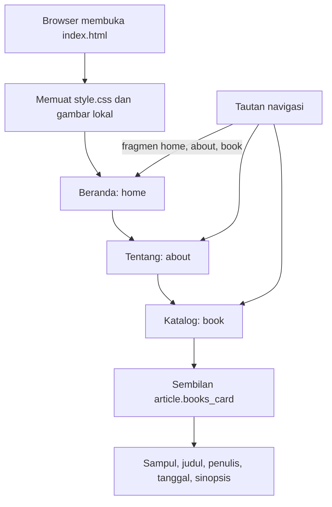

# Alur BUKA BUKU

## Dari halaman ke katalog

Aplikasi ini adalah satu halaman HTML/CSS. [index.html](../index.html) memuat seluruh isi katalog; tidak ada entry JavaScript, fetch API, database atau state penyimpanan browser.

Navigasi memakai fragmen HTML yang menunjuk ID `home`, `about` dan `book`. Tautan lewati navigasi menunjuk `content`; main mempunyai tabindex -1 untuk menerima fokus. Perpindahan ini ditangani browser, tanpa router aplikasi.

## Data dan tampilan

Setiap buku berada dalam satu article.books_card di [index.html](../index.html). Judul mempunyai ID unik yang juga dipakai aria-labelledby pada artikel. Sampul merujuk [image/](../image), sedangkan penulis, tanggal dan sinopsis ditulis langsung di markup. Informasi tidak diambil dari layanan penerbit.

[style.css](../style.css) mengatur lebar konten, navigasi, ukuran sampul dan grid katalog. Grid berubah dari satu menjadi dua lalu tiga kolom pada breakpoint 38rem dan 70rem. Di atas 52rem, header menjadi sticky dan scroll-padding memberi ruang pada tujuan fragmen. Sinopsis mengikuti tinggi isi kartu, bukan panel JavaScript yang dibuka/tutup.

Untuk mengubah satu buku, perbarui isi artikel dan src/alt sampul pada artikel yang sama. Buku baru membutuhkan ID judul unik, gambar lokal, serta penyesuaian jumlah buku yang ditampilkan dan ekspektasi pengujian. Tidak ada proses sinkronisasi katalog lain.

## Batas alur

Tidak ada pencarian, formulir akun, keranjang atau pembelian. Membaca kartu tidak mengirim data pengguna dan tidak menyimpan pilihan. Node/npm/Python pada folder pengujian bukan runtime halaman.

[Dockerfile](../Dockerfile) menyalin index.html, style.css dan image/ ke server statis. [docker/nginx.conf](../docker/nginx.conf) hanya menyajikan halaman, stylesheet dan gambar yang diizinkan; berkas dokumentasi/pengujian bukan endpoint aplikasi. Alternatif lokal dijelaskan di [README](../README.md).

## Pemeriksaan yang tersedia

[tests/browser.spec.js](../tests/browser.spec.js) memeriksa sembilan judul/gambar, navigasi fragmen, keyboard, keterbacaan sinopsis, metadata dan lebar 320/390/768 piksel. [playwright.config.js](../playwright.config.js) menyiapkan browser dan server pengujian. Dokumen ini disusun dari pembacaan sumber; penambahan dokumentasi tidak mengubah kode dan tidak menjalankan ulang aplikasi.
